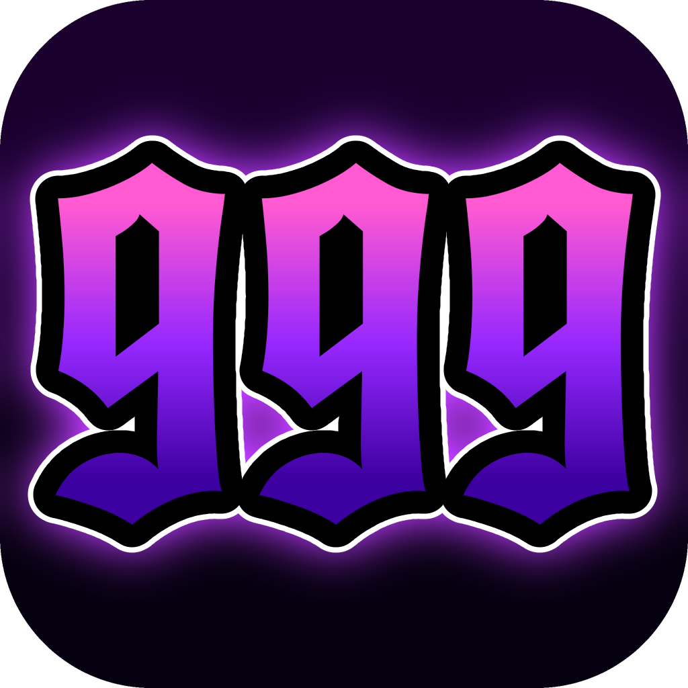
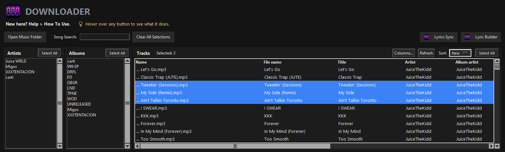
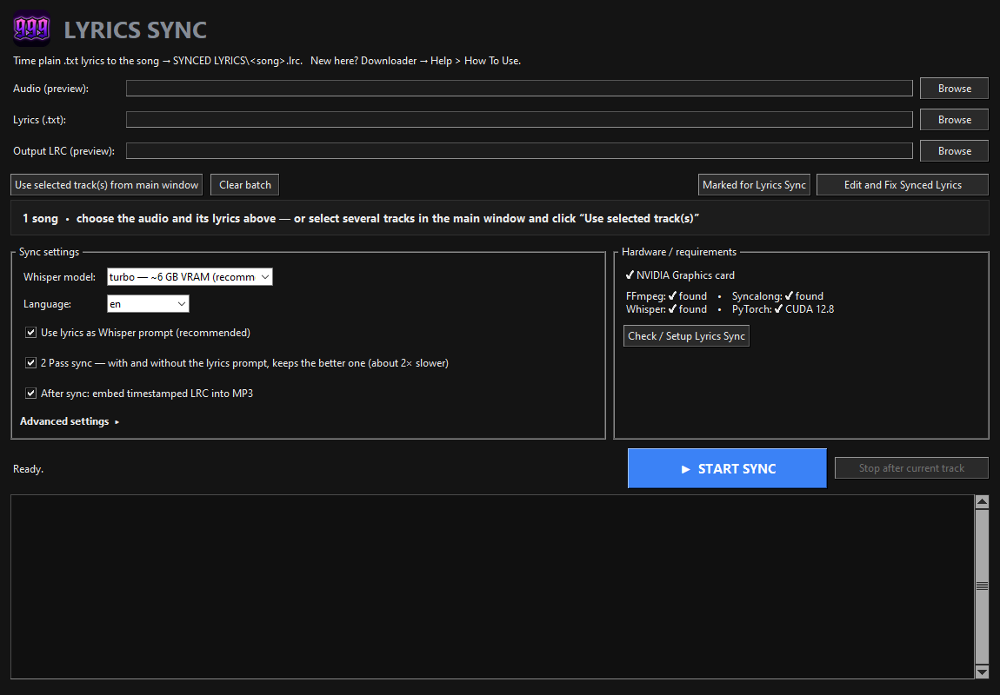

  

<h1 align="center">Triple 9 Studio</h1>

  Find, build and <b>time-sync lyrics</b> for your own music library — and keep its metadata tidy. 
  Windows • free • everything runs on your computer

  

---

## What is it?

Triple 9 Studio is a set of three tools for a local MP3 / FLAC collection:

| Tool | What it does |
|---|---|
| **Downloader** | Opens your music folder and shows every song with its lyrics status (🎶 synced, 📄 LRC file, ✅ lyrics downloaded …) and its tags in a sortable table. Downloads plain lyrics, finds problems, and has the metadata tools below. |
| **Lyrics Sync** | Takes a song and its text and writes a timed **.lrc** file (every line with its timestamp) using Whisper speech recognition — on your NVIDIA GPU when you have one. It can embed the result into the MP3. A waveform editor fixes the lines that went wrong. |
| **Lyric Builder** | Creates or completes a song's text from the audio when no lyrics exist. |

**Handy extras**

- **Metadata tab** – change tags of one song or many at once (set one Album / Artist for a whole selection like in Mp3tag), swap a song for a better file and keep all its metadata and cover, import dates / producer / studio from a Google Sheet.
- **Synced lyrics from a shared sheet** – match your songs with a public spreadsheet of `.lrc` files and download + embed them in one click.
- **Edit and Fix Synced Lyrics** – scans all your LRC files for timing mistakes (lines at the same time, lyrics that end long before the song, …) and opens a waveform editor at the problem.
- Safe by default: every change to a song is **backed up first**, and long jobs never freeze the window.

  

## Install (about 5 GB, 10–30 minutes, once)

You need **Windows 10 / 11**. No administrator rights, nothing is installed into Windows — the program keeps its own Python in its folder.

**Easiest:**

1. Download [`Triple9Studio-Setup.cmd`](https://github.com/imtatar999/Triple-9-Studio/releases/latest/download/Triple9Studio-Setup.cmd) and double-click it.
2. It downloads the newest version into the folder `C:\Users\<you>\Triple 9 Studio`, installs Python, Whisper, FFmpeg and the rest, and puts a **Triple 9 Studio** icon on your desktop.

**Or by hand:** [Download the ZIP](https://github.com/imtatar999/Triple-9-Studio/archive/refs/heads/main.zip), unpack it anywhere and double-click **`Install Triple 9 Studio.cmd`**.

Running the installer again repairs or completes an installation. Disk space: about **15 GB** free is recommended (speech models download the first time you sync a song).

## First steps

1. Start **Triple 9 Studio** (desktop icon) → **Downloader**.
2. **Open Music Folder** and pick the folder with your MP3 / FLAC files.
3. Select songs in **Tracks** and use the tab buttons below (hover a button to see what it does).
4. For timed lyrics open **Lyrics Sync**, choose a song and its text, click **START SYNC**.
5. For the lyrics download you can add a free Genius token in **Settings → Options**.

Full, step-by-step guide: **[docs/HOW-TO-USE.md](docs/HOW-TO-USE.md)** (the same text as *Help → How To Use* in the program).

## Updates

Triple 9 Studio checks GitHub a few seconds after it starts. When a newer version exists it asks whether to update; your settings, music, lyrics and the installed Python are never touched, and the files it replaces are saved to `BACKUPS\PROGRAM-UPDATES` first. You can also use **Help → Check for updates…** or turn the startup check off in the same menu.

## Also from us

- 🎧 **[Triple 9 Music Player](https://github.com/imtatar999/triple-9-music-player)** – our lossless player that shows the synced lyrics of your songs while they play. Recommended with this program.

## For developers

- Run from source: `python Triplenine_Lyrics_Studio.py` (inside the installed environment `runtime\app`).
- Tests: `python -m unittest discover -s SYNCED-LYRICS-DOWNLOADER-MAIN/TESTS -p "test_*.py"`.
- `python MAINTENANCE/make_docs.py` regenerates `docs/HOW-TO-USE.md` from the program's help text.
- A new version is a new git tag `vX.Y.Z` (and `VERSION` in `studio_version.py`); the updater installs the highest tag.

Your music, lyrics, tokens and settings are never stored in this repository (see `.gitignore`).
